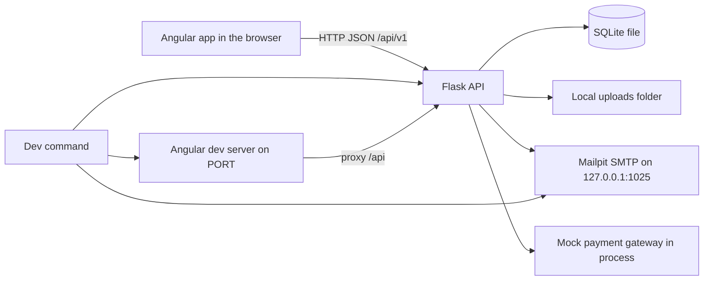
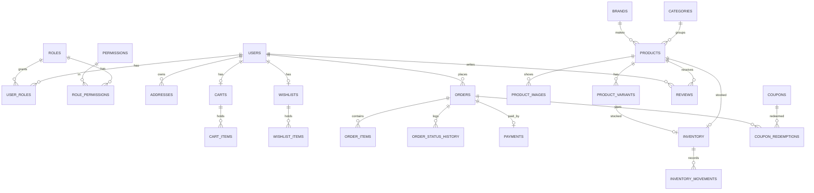

# Design: Enterprise-Grade E-Commerce Platform

## Overview

The app is one repository with two projects: an Angular storefront and admin dashboard in `frontend/`, and a Flask REST API over SQLite in `backend/`. A person opens the storefront at `/`; the admin dashboard lives under `/admin` in the same Angular app. Every screen reads and writes through the API under `/api/v1`, and the API is the only place that calculates money, validates coupons, reserves stock and decides who may see what.

The storefront is for Guest shoppers and Customers: home page, catalog with search and filters, product details, cart drawer, wishlist, multi-step checkout with a mock credit card payment, account area with order history and cancellation, and reviews. The admin dashboard is for Super Admin, Admin, Inventory Manager and Order Manager: overview KPIs and charts, product and category management, customer management, order management with invoices and CSV export, inventory with movements, coupons, reports, review moderation, admin users and the audit log.

Everything runs locally: SQLite file, local uploads folder, Mailpit as the development mail inbox, and a mock payment gateway. There is no cloud service, no external infrastructure and no deployment.

## Architecture



- **One origin in development.** The Angular dev server listens on `127.0.0.1` at the port in `PORT` and proxies `/api` to the Flask API, which listens on `127.0.0.1` at a port the dev command gives it (`API_PORT`, default 5001). The browser therefore talks to one origin, so no CORS problem arises in normal use; Flask-CORS still allows only `http://127.0.0.1:<PORT>` and `http://localhost:<PORT>`.
- **Layered backend.** Each module is a Flask blueprint under `backend/app/api/v1/`. A blueprint validates the request with a Marshmallow schema, calls a service, and the service uses SQLAlchemy models and repositories. Services own the business rules (totals, coupons, stock, status transitions, refunds); routes never calculate money.
- **Feature-based frontend.** `core/` holds the API client, interceptors, guards, auth state and the design tokens; `shared/` holds reusable UI components; each feature folder (`storefront`, `products`, `cart`, `wishlist`, `checkout`, `account`, `admin`, ...) is a lazy-loaded route group with its own components, services and styles.
- **Money.** Every amount is an integer number of US cents (`*_cents`). The API returns cents and the frontend formats them as USD. No floating point arithmetic touches money.

## Components and Interfaces

### Backend modules

| Module | Blueprint prefix | Responsibility |
| --- | --- | --- |
| auth | `/api/v1/auth` | register, login, refresh, logout, forgot/reset password, change password |
| users | `/api/v1/users` | profile, addresses |
| catalog | `/api/v1/products`, `/api/v1/categories`, `/api/v1/brands` | public catalog, search, filters, product details |
| cart | `/api/v1/cart` | cart items, totals, guest cart merge |
| wishlist | `/api/v1/wishlist` | wishlist items |
| checkout | `/api/v1/checkout` | coupon validation, delivery methods, order placement |
| orders | `/api/v1/orders` | customer order history, order details, cancel |
| payments | `/api/v1/payments` | mock gateway, refunds |
| reviews | `/api/v1/reviews` | customer reviews, product rating summary |
| admin | `/api/v1/admin` | products, categories, brands, customers, orders, inventory, coupons, reviews, users, audit |
| analytics | `/api/v1/admin/analytics` | dashboard KPIs and charts |
| reports | `/api/v1/admin/reports` | report data and CSV export |
| mail | internal | Mailpit SMTP adapter, newsletter |
| health | `/api/health` | liveness |

### Frontend structure

```
frontend/src/app/
  core/            api client, auth service, interceptors, guards, models, tokens
  shared/          button, field, card, table, dialog, toast, skeleton, empty state, pagination
  storefront/      home page, layout, header, footer, newsletter
  products/        catalog, filters, product details, gallery, reviews
  cart/            cart drawer, cart page
  wishlist/        wishlist page
  checkout/        checkout wizard, payment form, confirmation
  account/         overview, profile, addresses, orders, order details, reviews
  admin/           layout, overview, products, categories, customers, orders,
                   inventory, coupons, reports, reviews, users, audit
```

### Authentication and authorization

- Passwords are hashed with Argon2id (`argon2-cffi`).
- `POST /api/v1/auth/login` returns a short-lived access token (15 minutes) and a refresh token (7 days). The access token is sent as `Authorization: Bearer <token>`. The refresh token is stored in an `HttpOnly`, `SameSite=Strict` cookie scoped to `/api/v1/auth`, so it is never readable by JavaScript; the API also accepts it in the JSON body for tests.
- Refresh tokens are rows in `refresh_tokens` with `jti`, `user_id`, `expires_at`, `revoked_at`. `POST /api/v1/auth/refresh` rotates: it revokes the presented token and issues a new pair. `POST /api/v1/auth/logout` revokes it.
- Every protected route uses `@jwt_required()` plus a permission decorator `@require_permission("products.manage")`. Permissions are seeded rows; roles map to permissions through `role_permissions`. A missing permission answers `403` with `{"error": {"code": "forbidden", "message": "You do not have permission to do this"}}`.
- Ownership checks live in the service layer: a Customer reading an order, address or profile that is not theirs gets the same `403` answer.
- Rate limiting (`Flask-Limiter`, in-memory) applies to `/auth/login`, `/auth/register`, `/auth/forgot-password` and `/auth/reset-password`: 10 requests per minute per IP, and 5 failed logins per email per 15 minutes.
- CSRF: because the access token travels in a header and the refresh cookie is `SameSite=Strict`, no cookie-authenticated state-changing endpoint exists; the refresh endpoint is the only cookie reader and it only issues tokens.

### Roles and permissions

| Permission | Super Admin | Admin | Inventory Manager | Order Manager | Customer |
| --- | --- | --- | --- | --- | --- |
| `dashboard.view` | yes | yes | no | no | no |
| `products.manage` | yes | yes | no | no | no |
| `categories.manage` | yes | yes | no | no | no |
| `customers.manage` | yes | yes | no | no | no |
| `orders.manage` | yes | yes | no | yes | no |
| `inventory.manage` | yes | no | yes | no | no |
| `reports.view` | yes | yes | no | no | no |
| `coupons.manage` | yes | yes | no | no | no |
| `reviews.moderate` | yes | yes | no | no | no |
| `users.manage` | yes | no | no | no | no |
| `audit.view` | yes | no | no | no | no |

First screen after sign-in: Super Admin and Admin → `/admin`; Inventory Manager → `/admin/inventory`; Order Manager → `/admin/orders`; Customer → `/`. `/` opens the home page for everyone; a signed-in admin who opens `/` sees the storefront.

## Data Models

SQLite with `PRAGMA foreign_keys = ON` set on every connection. All tables have `created_at` and `updated_at` (UTC). Money columns are `Integer` cents. Soft deletion uses `deleted_at` on `products`, `categories`, `brands` and `users`.

| Table | Key columns | Notes |
| --- | --- | --- |
| `users` | id, email (unique), password_hash, first_name, last_name, phone, is_active, deleted_at | one row per person, customers and admins |
| `roles` | id, name (unique), description | 5 seeded rows |
| `permissions` | id, name (unique), description | seeded |
| `user_roles` | user_id, role_id | many-to-many |
| `role_permissions` | role_id, permission_id | many-to-many |
| `refresh_tokens` | id, jti (unique), user_id, expires_at, revoked_at | rotation and revocation |
| `password_reset_tokens` | id, user_id, token_hash (unique), expires_at, used_at | 1 hour lifetime |
| `categories` | id, name, slug (unique), description, image_url, parent_id, status, sort_order, deleted_at | self-referencing tree |
| `brands` | id, name (unique), description, logo_url, deleted_at | |
| `products` | id, name, sku (unique), slug (unique), description, short_description, brand_id, category_id, regular_price_cents, discounted_price_cents, discount_percentage, status, is_featured, is_new_arrival, rating_average, rating_count, deleted_at | status draft/published/archived |
| `product_images` | id, product_id, url, alt_text, sort_order | |
| `product_variants` | id, product_id, sku (unique), name, price_cents, attributes (JSON), status | independent stock |
| `product_attributes` | id, name | |
| `product_attribute_values` | id, attribute_id, value | |
| `product_variant_values` | variant_id, attribute_value_id | |
| `inventory` | id, product_id, variant_id (nullable), quantity, reserved_quantity, low_stock_threshold | unique on (product_id, variant_id) |
| `inventory_movements` | id, inventory_id, quantity_change, reason, created_by, created_at | append-only |
| `addresses` | id, user_id, type, line1, line2, city, state, postal_code, country, is_default | |
| `carts` | id, user_id (nullable for guest), guest_token (nullable), status | active/converted/abandoned |
| `cart_items` | id, cart_id, product_id, variant_id, quantity, unit_price_cents | unique on (cart_id, product_id, variant_id) |
| `wishlists` | id, user_id (unique) | |
| `wishlist_items` | id, wishlist_id, product_id, added_at | unique on (wishlist_id, product_id) |
| `orders` | id, order_number (unique), user_id, status, payment_status, subtotal_cents, discount_cents, shipping_cents, tax_cents, total_cents, coupon_id, shipping_address_id, billing_address_id, delivery_method, placed_at | |
| `order_items` | id, order_id, product_id, variant_id, product_name, sku, quantity, unit_price_cents, total_cents | snapshot of name and price |
| `order_status_history` | id, order_id, status, changed_by, changed_at, note | |
| `payments` | id, order_id, amount_cents, status, method, transaction_id, created_at | no card data |
| `coupons` | id, code (unique), type, value, min_order_value_cents, max_discount_cents, expires_at, usage_limit, per_customer_limit, is_active, category_id (nullable) | |
| `coupon_redemptions` | id, coupon_id, user_id, order_id, redeemed_at | |
| `reviews` | id, product_id, user_id, rating, comment, is_verified_purchase, status, created_at | unique on (product_id, user_id) |
| `audit_logs` | id, user_id, action, entity_type, entity_id, details (JSON), created_at | append-only |
| `newsletter_subscribers` | id, email (unique), created_at | |

Indexes: `products(status, category_id)`, `products(brand_id)`, `products(name)`, `orders(user_id, placed_at)`, `orders(status)`, `orders(order_number)`, `inventory(product_id)`, `reviews(product_id, status)`, `audit_logs(created_at)`, `inventory_movements(inventory_id, created_at)`.

### Entity relationships



## Money, tax, shipping and coupons

- **Line total** = `unit_price_cents * quantity`, where `unit_price_cents` is the product's discounted price (or the variant's price) read from the database at the moment of the request.
- **Subtotal** = sum of line totals of items that are in stock.
- **Coupon discount**: percentage coupons give `round(subtotal * value / 100)` capped at `max_discount_cents`; fixed coupons give `min(value, subtotal)`. A coupon is refused when inactive, expired, over `usage_limit`, over `per_customer_limit` for that customer, below `min_order_value_cents`, or when the cart holds no product of its restricted category.
- **Shipping**: Standard 500 cents, Express 1200 cents, Next day 2500 cents; Standard is 0 when the discounted subtotal is at least 10000 cents.
- **Tax** = `round((subtotal - discount) * 8 / 100)`, an estimate.
- **Total** = `subtotal - discount + shipping + tax`.
- **Refund** on cancellation = the order's `total_cents`, recorded at once.

## API contract

All responses are JSON. Success bodies are the resource or `{"data": ..., "meta": {...}}` for lists. Errors are `{"error": {"code": "<code>", "message": "<message>", "fields": {"<field>": "<message>"}}}` with status 400 (validation), 401 (unauthenticated), 403 (forbidden), 404 (not found), 409 (conflict), 422 (business rule), 429 (rate limited), 500 (unexpected). List endpoints take `page` (default 1), `per_page`, `sort`, `q` and filter parameters, and answer `meta: {page, per_page, total, total_pages}`.

### Auth

| Method | Path | Body | Answer |
| --- | --- | --- | --- |
| POST | `/api/v1/auth/register` | `first_name, last_name, email, password, phone` | 201 `{user, access_token, refresh_token}`; 409 `email_taken` "An account with this email already exists"; 400 `weak_password` |
| POST | `/api/v1/auth/login` | `email, password` | 200 `{user, access_token, refresh_token}`; 401 `invalid_credentials` "Invalid email or password"; 403 `inactive` "This account is inactive" |
| POST | `/api/v1/auth/refresh` | cookie or `{refresh_token}` | 200 `{access_token, refresh_token}`; 401 `session_expired` |
| POST | `/api/v1/auth/logout` | `{refresh_token}` | 204 |
| POST | `/api/v1/auth/forgot-password` | `email` | 200 `{message: "If the email is registered, a reset link has been sent"}` |
| POST | `/api/v1/auth/reset-password` | `token, password` | 200; 400 `invalid_token` "This reset link is no longer valid" |
| POST | `/api/v1/auth/change-password` | `current_password, new_password` | 200; 400 `wrong_password` |

`user` = `{id, email, first_name, last_name, phone, roles: ["Customer"], permissions: ["orders.place"], is_active}`.

### Catalog

| Method | Path | Notes |
| --- | --- | --- |
| GET | `/api/v1/products` | `q, category, brand, min_price, max_price, in_stock, min_rating, sort (price_asc, price_desc, newest, popular, rating), page, per_page` |
| GET | `/api/v1/products/search` | `q` (min 2 chars) → `{suggestions: [{id, name, slug, image_url, price_cents}]}` max 6 |
| GET | `/api/v1/products/{id_or_slug}` | full product with images, variants, attributes, rating summary, approved reviews (first page), related products |
| GET | `/api/v1/products/{id}/reviews` | approved reviews, paginated |
| GET | `/api/v1/categories` | tree of active categories with product counts |
| GET | `/api/v1/brands` | list |
| GET | `/api/v1/storefront/home` | `{hero, featured_categories, trending, best_selling, new_arrivals, offers, testimonials}` each product list max 8 |
| POST | `/api/v1/newsletter` | `{email}` → 201 |

Product summary = `{id, name, slug, sku, short_description, image_url, brand, category, regular_price_cents, discounted_price_cents, discount_percentage, in_stock, available_quantity, rating_average, rating_count, is_featured, is_new_arrival}`.

### Cart and wishlist

| Method | Path | Body | Answer |
| --- | --- | --- | --- |
| GET | `/api/v1/cart` | — | `{items, subtotal_cents, discount_cents, tax_cents, shipping_cents, total_cents, item_count, coupon}` |
| POST | `/api/v1/cart/items` | `product_id, variant_id?, quantity` | 201 cart; 422 `insufficient_stock` "Only N left in stock" |
| PUT | `/api/v1/cart/items/{id}` | `quantity` | 200 cart; 422 `insufficient_stock` |
| DELETE | `/api/v1/cart/items/{id}` | — | 200 cart |
| POST | `/api/v1/cart/merge` | `{guest_token}` | 200 cart |
| POST | `/api/v1/cart/coupon` | `{code}` | 200 cart; 422 `invalid_coupon` "This coupon cannot be used for this order" |
| DELETE | `/api/v1/cart/coupon` | — | 200 cart |
| GET | `/api/v1/wishlist` | — | `{items: [{id, product, available}]}` |
| POST | `/api/v1/wishlist/items` | `product_id` | 201; 409 `already_saved` "Already in your wishlist" |
| DELETE | `/api/v1/wishlist/items/{id}` | — | 204 |
| POST | `/api/v1/wishlist/items/{id}/move-to-cart` | — | 200 cart |

A guest cart is identified by a `guest_token` the frontend generates and sends in the `X-Guest-Token` header; on sign-in the frontend calls `/cart/merge`.

### Checkout, orders and payments

| Method | Path | Body | Answer |
| --- | --- | --- | --- |
| GET | `/api/v1/checkout/summary` | `coupon_code?, delivery_method?` | `{items, subtotal_cents, discount_cents, shipping_cents, tax_cents, total_cents, delivery_methods}` |
| POST | `/api/v1/checkout/place-order` | `shipping_address_id or shipping_address, billing_address_id or billing_address, delivery_method, coupon_code?, payment: {card_number, expiry, cvc}` | 201 `{order}`; 422 `out_of_stock` "Some items are no longer available" with `items`; 402 `payment_failed` "Payment was not completed" |
| GET | `/api/v1/orders` | `page` | customer's orders, 10 per page |
| GET | `/api/v1/orders/{id}` | — | order with items, addresses, payment, status history |
| POST | `/api/v1/orders/{id}/cancel` | — | 200 order; 422 `cannot_cancel` "This order can no longer be cancelled" |
| GET | `/api/v1/users/me` | — | profile |
| PUT | `/api/v1/users/me` | `first_name, last_name, phone` | 200 |
| GET/POST/PUT/DELETE | `/api/v1/users/me/addresses[/{id}]` | address fields | address book |
| GET | `/api/v1/users/me/reviews` | — | reviews with status |

Order = `{id, order_number, status, payment_status, subtotal_cents, discount_cents, shipping_cents, tax_cents, total_cents, delivery_method, placed_at, items: [{product_id, variant_id, name, sku, quantity, unit_price_cents, total_cents}], shipping_address, billing_address, payment: {status, method, transaction_id}, status_history: [{status, changed_at, changed_by}]}`.

Order statuses: `pending → confirmed → processing → shipped → delivered`; `cancelled` from pending, confirmed or processing; `refunded` from delivered. Payment statuses: `pending, success, failed, cancelled, refunded`.

### Reviews

| Method | Path | Body | Answer |
| --- | --- | --- | --- |
| POST | `/api/v1/products/{id}/reviews` | `rating, comment` | 201 `{review}` status pending; 409 `already_reviewed` |

### Admin

| Method | Path | Notes |
| --- | --- | --- |
| GET | `/api/v1/admin/products` | `q, status, category, brand, page, per_page=20` |
| POST | `/api/v1/admin/products` | create (status draft); 409 `duplicate_sku` "This SKU is already in use" |
| GET/PUT/DELETE | `/api/v1/admin/products/{id}` | update; delete archives |
| POST | `/api/v1/admin/products/{id}/images` | multipart `file`; 400 `invalid_image` "Images must be JPEG or PNG and 5 MB or less" |
| DELETE | `/api/v1/admin/products/{id}/images/{image_id}` | |
| POST | `/api/v1/admin/products/{id}/variants` | variant with own SKU, price, stock |
| POST | `/api/v1/admin/products/bulk` | `{ids, action: publish\|unpublish\|archive}` |
| GET/POST/PUT/DELETE | `/api/v1/admin/categories[/{id}]` | tree; 409 `category_has_products` "Move or archive this category's products first" |
| GET/POST/PUT/DELETE | `/api/v1/admin/brands[/{id}]` | |
| GET | `/api/v1/admin/customers` | `q, page, per_page=20` |
| GET | `/api/v1/admin/customers/{id}` | profile, addresses, orders, spending |
| PATCH | `/api/v1/admin/customers/{id}` | `{is_active}` |
| GET | `/api/v1/admin/orders` | `q, status, from, to, page, per_page=20` |
| GET | `/api/v1/admin/orders/{id}` | full order |
| PATCH | `/api/v1/admin/orders/{id}/status` | `{status}`; 422 `invalid_transition` "This status change is not allowed" |
| POST | `/api/v1/admin/orders/{id}/refund` | full mock refund |
| GET | `/api/v1/admin/orders/{id}/invoice` | printable HTML |
| GET | `/api/v1/admin/orders/export` | CSV of current filters |
| GET | `/api/v1/admin/inventory` | `low_stock, out_of_stock, q, page` |
| PATCH | `/api/v1/admin/inventory/{id}` | `{quantity, reason}`; 422 `negative_stock` "Stock cannot go below zero" |
| GET | `/api/v1/admin/inventory/{id}/movements` | |
| GET/POST/PUT | `/api/v1/admin/coupons[/{id}]` | 409 `duplicate_code` "This coupon code already exists" |
| GET | `/api/v1/admin/coupons/{id}` | redemption count and orders |
| GET | `/api/v1/admin/reviews` | `status, page` |
| PATCH | `/api/v1/admin/reviews/{id}` | `{status: approved\|rejected}` |
| GET | `/api/v1/admin/users` | admin accounts with role and status |
| PATCH | `/api/v1/admin/users/{id}` | `{role_id, is_active}` |
| GET | `/api/v1/admin/audit-logs` | `user_id, entity_type, from, to, page` |
| GET | `/api/v1/admin/analytics/overview` | `from, to` → KPIs, revenue trend, top products, top categories, recent orders, recent customers, previous-period revenue |
| GET | `/api/v1/admin/analytics/sales` | `from, to, group_by=day\|week\|month\|quarter\|year` |
| GET | `/api/v1/admin/reports/{report}` | `report` in revenue, orders, products, categories, customers, inventory; `from, to, group_by` |
| GET | `/api/v1/admin/reports/{report}/export` | CSV |

## Error Handling

- A single Flask error handler turns every exception into the error envelope above. `ValidationError` → 400 with `fields`; `PermissionError` → 403; `NotFoundError` → 404; `BusinessRuleError(code, message)` → 422; anything else → 500 with `{"code": "server_error", "message": "Something went wrong. Please try again."}` and the traceback written to the log file only.
- The Angular `errorInterceptor` maps the envelope to a toast: `role="alert"` for errors, `role="status"` for success, visible for at least 5 seconds. A 401 triggers one refresh attempt; if the refresh fails, the auth service clears the session and routes to `/sign-in?reason=expired`, which shows "Your session has expired. Please sign in again".
- Loading states use skeleton components; empty lists use the shared empty-state component with the action that creates the first record.

## Testing Strategy

- **Backend (pytest).** Each test module builds its own app with a temporary SQLite file (`tmp_path`), runs `flask db upgrade` against it, and seeds only what it needs. Tests cover registration, login, refresh rotation, authorization per role, ownership, product CRUD, search and filters, cart totals, coupon rules, checkout reservation and rollback, payment failure, cancellation and refund, inventory movements, review moderation, reports and audit logs. A concurrency test places two orders for the last unit from two threads and asserts one succeeds.
- **Frontend (Jest via `jest-preset-angular`).** Component tests for forms and validation, guards, interceptors, cart and filter components, with `HttpTestingController` standing in for the API.
- **End-to-end (Playwright).** The `e2e/` folder holds the journeys Greenfield's Tester saves; they run against the running app only.
- **Accessibility.** Component tests assert labels, `aria-invalid`, `aria-describedby`, `role="status"`/`role="alert"` and focus movement in dialogs; Playwright journeys check keyboard operation and the 375 px and 1440 px layouts.

## Build and run
Install: npm run install:all
Test: npm test
Run locally: yes
Dev: npm run dev
Port variable: PORT
Health path: /api/health
Devices: both
Deploy: none

`npm run install:all` installs the root, `frontend/` and `backend/` dependencies (the backend's Python packages into `backend/.venv`). `npm test` runs the backend pytest suite and the frontend Jest suite once each and exits. `npm run dev` starts Mailpit, applies migrations, seeds an empty database, then starts the Flask API on `127.0.0.1:5001` and the Angular dev server on `127.0.0.1:$PORT` with the `/api` proxy.

## Test logins

- Super Admin — admin@example.com / Admin@12345
- Customer — customer@example.com / Customer@12345

The seed script also creates one Admin (`manager@example.com` / `Manager@12345`), one Inventory Manager (`inventory@example.com` / `Inventory@12345`) and one Order Manager (`orders@example.com` / `Orders@12345`), all local-development only.

## Look and feel

A premium, minimal enterprise commerce style: generous white space, a deep ink text colour, one confident accent, soft elevation and 12 px corners. Angular Material provides the behaviour (dialogs, menus, tables, form fields); its theme is overridden with the tokens below so the storefront and the dashboard look like one product.

**Colour tokens** (CSS variables in `frontend/src/styles/tokens.css`):

| Token | Value | Use |
| --- | --- | --- |
| `--color-bg` | `#F7F8FA` | page background |
| `--color-surface` | `#FFFFFF` | cards, tables, dialogs |
| `--color-text` | `#111827` | primary text |
| `--color-text-muted` | `#4B5563` | secondary text |
| `--color-border` | `#D1D5DB` | borders, dividers |
| `--color-primary` | `#1D4ED8` | main actions, links, active nav |
| `--color-primary-hover` | `#1E40AF` | hover |
| `--color-primary-soft` | `#EFF3FF` | selected rows, chips |
| `--color-error` | `#B91C1C` | errors, destructive actions |
| `--color-success` | `#047857` | success toasts, in-stock |
| `--color-warning` | `#B45309` | low stock, pending |
| `--color-focus` | `#1D4ED8` | focus ring |

**Typography**: `Inter` (bundled locally, fallback `system-ui, sans-serif`). Scale: 12 / 14 / 16 / 18 / 24 / 32 / 48 px, line heights 1.5 for body and 1.2 for headings; headings weight 600, body 400.

**Spacing**: 4 px base — 4, 8, 12, 16, 24, 32, 48, 64. **Radius**: 8 px for fields and buttons, 12 px for cards and dialogs, 999 px for chips and pills. **Elevation**: `0 1px 2px rgba(17,24,39,.06)` resting, `0 8px 24px rgba(17,24,39,.12)` on hover and dialogs. **Breakpoints**: 375–767 phone, 768–1199 tablet, 1200+ desktop.

**Components**:
- *Buttons*: primary filled `--color-primary` with white text; secondary outlined; ghost text-only; destructive filled `--color-error`. Height 40 px (48 px on phone), 8 px radius, 600 weight. Hover darkens, pressed scales to 0.98, disabled at 40% opacity with `cursor: not-allowed`, focus shows a 2 px `--color-focus` outline with 2 px offset.
- *Fields*: 44 px tall, 1 px `--color-border`, 8 px radius, visible label above, helper text below, error text in `--color-error` with `aria-invalid` and `aria-describedby`. Focus border `--color-primary` plus 2 px ring.
- *Cards*: white surface, 12 px radius, resting elevation, lift on hover for product cards, image with 4:3 ratio and `object-fit: cover`.
- *Tables*: white surface, 56 px rows, sticky header in `--color-bg`, sortable column headers with an arrow, zebra-free with 1 px dividers, row hover `--color-primary-soft`.
- *Lists*: 1 px dividers, 16 px vertical padding, muted secondary line.
- *Toasts*: bottom-right on desktop, top on phone; success with `--color-success` icon and `role="status"`, error with `--color-error` and `role="alert"`; 5 s minimum.
- *Skeletons*: `--color-bg` blocks with a shimmer; *empty states*: centred icon, one sentence, one primary action.
- *Navigation*: storefront header 72 px with logo, mega-menu categories, search with autocomplete, wishlist, cart icon with count badge, account menu; admin sidebar 248 px with grouped links and a top bar with the person's name and role.

**Screens**:
- *Home*: desktop — full-width hero (image right, headline and CTA left), then featured categories as a 6-up row of image tiles, trending and best-selling as 4-up product grids, a promotional band, new arrivals, testimonials as a 3-up row, newsletter band, four-column footer. Phone — hero stacks, categories scroll horizontally, product grids become 2-up, footer accordions.
- *Catalog*: desktop — 264 px filter rail on the left, 3-up product grid on the right, sort and result count above, pagination below. Phone — single column 2-up grid, "Filters" button opens a bottom sheet with the same filters.
- *Product details*: desktop — gallery left (main image with thumbnails), buy box right (name, rating, price, variants as chips, quantity stepper, Add to cart, Add to wishlist), tabs for description and specifications below, then reviews and related products. Phone — gallery on top, buy box below, sticky Add to cart bar at the bottom.
- *Cart*: a right-side drawer 420 px wide on desktop, full screen on phone, with line items, quantity steppers, coupon field, totals and Checkout button; a full cart page mirrors it.
- *Checkout*: desktop — stepper across the top, form on the left, sticky order summary on the right. Phone — one step per screen with Back/Continue at the bottom and a collapsible summary.
- *Account*: desktop — left menu (Overview, Profile, Addresses, Orders, Reviews), content right. Phone — menu becomes a horizontal tab strip.
- *Admin*: desktop — sidebar plus content area with page title, filters bar and data table or chart grid. Phone — sidebar collapses into a drawer opened from a menu button; tables scroll horizontally inside their card.
- *Admin overview*: 4-up KPI cards, revenue trend chart (Chart.js line), top products and categories as bar charts, recent orders and customers as compact tables.

## Assumptions

- The Angular dev server proxies `/api` to the Flask API on `127.0.0.1:5001`, so the browser uses one origin; the API port is set by the dev command through `API_PORT`.
- The refresh token is kept in an `HttpOnly` cookie and the access token in memory; the API also accepts a refresh token in the request body so tests can call it without a browser.
- Mailpit is started by the dev command and the API sends reset links to `http://127.0.0.1:8025`; the reset link points at the Angular route `/reset-password?token=...`.
- Product images are stored in `backend/uploads/` and served at `/uploads/<file>`; the seed script copies sample images from `backend/seed/images/`.
- The mock payment gateway accepts any 16-digit card number with a future expiry and any 3-digit security code, and never stores them; a card number ending in `0000` simulates a failure and a card ending in `9999` simulates a cancellation.
- Guest carts are identified by a `guest_token` in the `X-Guest-Token` header and merged into the customer's cart on sign-in.
- Recently viewed products are kept in the browser's local storage, at most 6.
- The newsletter form stores the email in `newsletter_subscribers` and shows "Thanks for subscribing".
- The admin dashboard is served under `/admin` in the same Angular app.
- The app is used on desktop and phone browsers and does not work offline.
